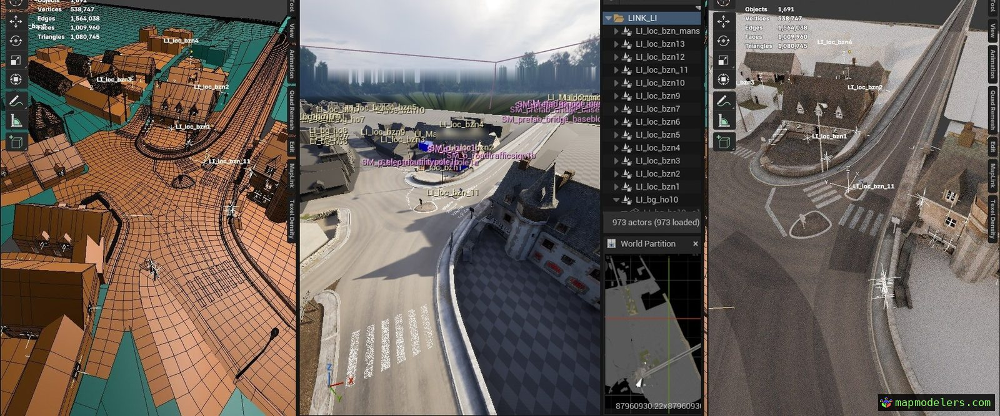

# MapLink

> **Experimental, in progress.** Built with AI. Prebuilt for Unreal Engine 5.7 (Win64) in [Releases](https://github.com/mapmodelers/MapLink/releases); more engine versions soon.

The source is public and built with AI. To adapt it to your own pipeline, AI is the recommended way.

**Blender as source of truth for Unreal hierarchical mappings.**

## Features

- `.blend` hierarchies become Level Instances, Blueprints and static meshes
- Every reimport rebuilds from the `.blend`, with an integrity check
- Materials and textures synced both ways
- World Partition expansion
- Blender addon: asset shelf, vendor-in, standardization, batch tools
- Perforce optional

## Install

Tested on Windows 10, Unreal Engine 5.7.1, Blender 5.0. Back up your project first.

1. [Releases](https://github.com/mapmodelers/MapLink/releases) zip → `<YourProject>/Plugins/MapLink`.
2. Open the project. **MapLink → Install / Update Blender Addon**.
3. **MapLink → New MapLink Project…**

From source: C++ project, Visual Studio 2022.

[Documentation](https://docs.mapmodelers.com/maplink/) · [Specifications](docs/SPECS.md)

## Bugs

[Issues](https://github.com/mapmodelers/MapLink/issues), with your UE and Blender versions, the steps, and the output of **MapLink → Copy Diagnostics**. Feedback and ideas: [Discussions](https://github.com/mapmodelers/MapLink/discussions).

Updates: on GitHub, **Watch → Custom → Releases**.

## AI

Built with AI, directed and tested by MapModelers. Specifications, conventions and source are written for models to read: AI is the recommended way to study or adapt this code for your own use, within the license. AI agents: start with [AGENTS.md](AGENTS.md).

## License

Unreal plugin: free for individuals, education, and organizations under 50 staff and €10M turnover, on projects under €1M budget. Larger organizations or budgets: [support@mapmodelers.com](mailto:support@mapmodelers.com). Blender addon (`MapLink/blender/`): GPL-3.0-or-later. Terms: [LICENSE.md](LICENSE.md).
